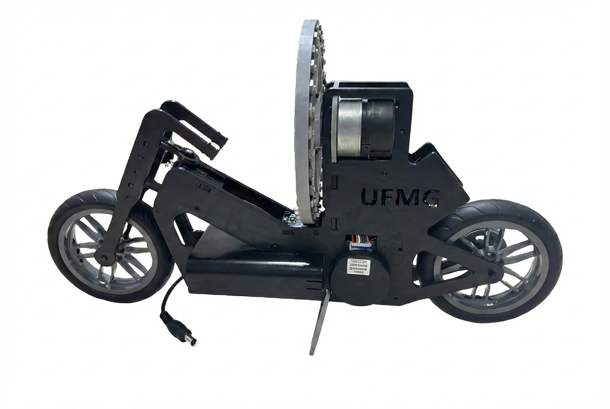
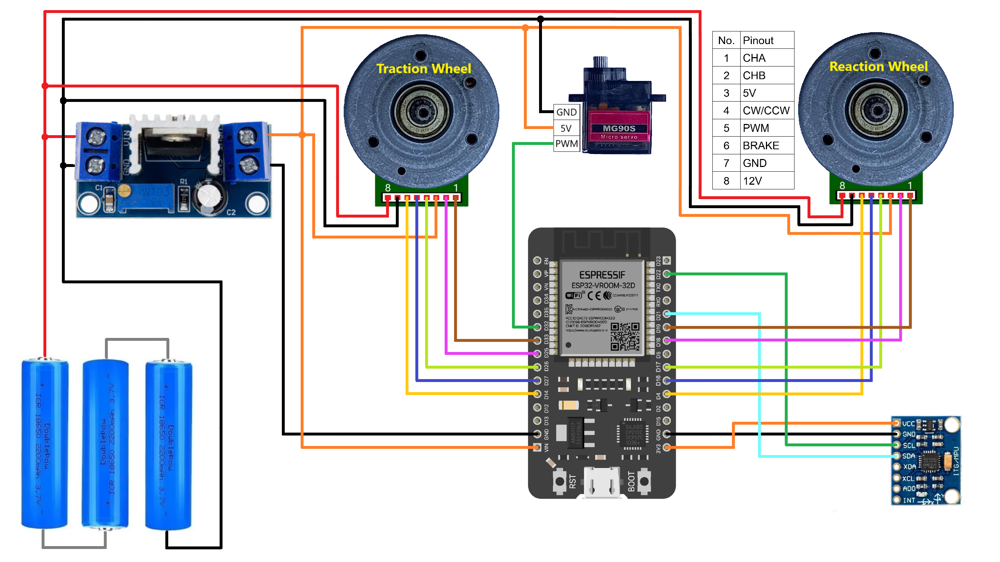

# Reaction-Wheel-Balanced Bicycle (REWBI)

REWBI is a low-cost, modular, open-source bicycle platform developed at the Universidade Federal de Minas Gerais (UFMG), Brazil, for control research and education.

The platform connects mechanical fabrication, embedded programming, mathematical modeling, and controller design through reaction-wheel stabilization and traction-speed experiments.

The project files are distributed under the MIT License.  
Copyright (c) 2024 GTI - UFMG

---

## 🔩 Hardware

- 1× ESP32 DevKit V1 development board with 30 pins
- 1× GY-521 inertial-sensor module based on the MPU-6050
- 2× NIDEC 24H brushless DC motor assemblies with integrated drivers and encoders
- 1× MG90S metal-gear steering servomotor
- 2× motorcycle wheel-and-tire assemblies corresponding to parts 88517 and 88516
- 1× front wheel axle and 1× rear wheel axle
- 1× closed-loop GT2 timing belt with 2 mm tooth pitch, 280 mm circumference, and 6 mm width
- 1× LM317-based adjustable linear voltage-regulator module configured for a 5 V output
- 1× battery-case module for three 18650 lithium-ion cells
- 3× 18650 lithium-ion cells
- 3D-printed ABS parts, including the frame, reaction wheel, holders, gears, and spacers
- Screws, nuts, connectors, and wiring

The component and fastener list is available in [Component List.txt](Component%20List.txt).

---

## 🛠️ Features

- Reaction-wheel balance control using an LQR controller with integral action.
- Onboard roll-angle estimation from accelerometer and gyroscope measurements.
- Encoder feedback for motor-speed measurement.
- Traction-speed modeling and PI-controller design.
- Modular mechanical structure with STL fabrication files.
- Python notebooks for controller design, simulation, and experimental comparisons.
- Experimental datasets for balance and velocity-control analysis.

---

## ⚙️ How It Works

1. The GY-521 module provides acceleration and angular-rate measurements, which the ESP32 uses to estimate the bicycle's roll motion.
2. Encoder measurements provide feedback on the reaction-wheel speed.
3. The LQR controller computes the reaction-wheel motor command. Accelerating or decelerating the wheel produces an opposing torque on the bicycle body, counteracting deviations from the upright position.
4. A separate motor drives the rear wheel through the timing belt, while the MG90S servomotor turns the front fork.
5. Experimental measurements can be copied from the Arduino IDE Serial Monitor, saved as text files, and processed using the supplied Python notebooks.

---

## 📂 Main Repository Files

- [Arduino IDE Configuration.txt](Arduino%20IDE%20Configuration.txt) — ESP32 programming-environment configuration.
- [Component List.txt](Component%20List.txt) — Electronic components, fasteners, and wiring materials.
- [3D printing files/](3D%20printing%20files/) — STL models for the mechanical structure.
  - [Extra/](3D%20printing%20files/Extra/) — Printable alternatives to the purchased wheels, tires, and axles.
- **Arduino codes/** — Firmware and experimental examples.
  - [Balance/LQR/LQR.ino](Arduino%20codes/Balance/LQR/LQR.ino) — Standalone LQR balance control.
  - [Experiments/LQR_experiment/LQR_experiment.ino](Arduino%20codes/Experiments/LQR_experiment/LQR_experiment.ino) — Balance experiments with a programmed disturbance and data recording.
  - [Experiments/test_components/test_components.ino](Arduino%20codes/Experiments/test_components/test_components.ino) — Open-loop component diagnostics.
- **Python codes/** — Controller-design notebooks and experimental datasets.
  - [Balance_LQR_Controller_Design.ipynb](Python%20codes/Balance_LQR_Controller_Design.ipynb) — Balance modeling, continuous- and discrete-time LQR design, nonlinear simulation, and experimental comparisons.
  - [Velocity_PI_Controller_Design.ipynb](Python%20codes/Velocity_PI_Controller_Design.ipynb) — First-order velocity-model parameter estimation, PI-controller design, and experimental comparisons.
  - [pulseData.txt](Python%20codes/pulseData.txt) and [stepData.txt](Python%20codes/stepData.txt) — Balance-test measurements.
  - [motorStep.txt](Python%20codes/motorStep.txt) and [motorControl.txt](Python%20codes/motorControl.txt) — Open-loop motor-response and closed-loop velocity-control measurements.
- **Images/** — Photograph of the assembled platform and electrical diagram.

---

## 📸 Images

<table>
  <tr>
    <td align="center" width="50%">
      
    </td>
    <td align="center" width="50%">
      
    </td>
  </tr>
  <tr>
    <td align="center">
      <em>Assembled REWBI platform.</em>
    </td>
    <td align="center">
      <em>Electrical schematic and wiring diagram.</em>
    </td>
  </tr>
</table>

---

## 🎥 Demonstration Video

